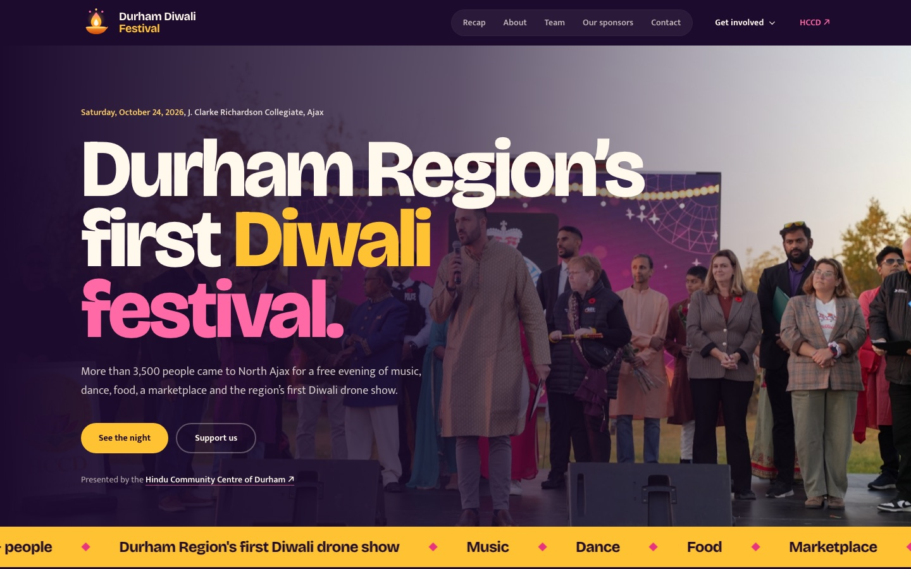
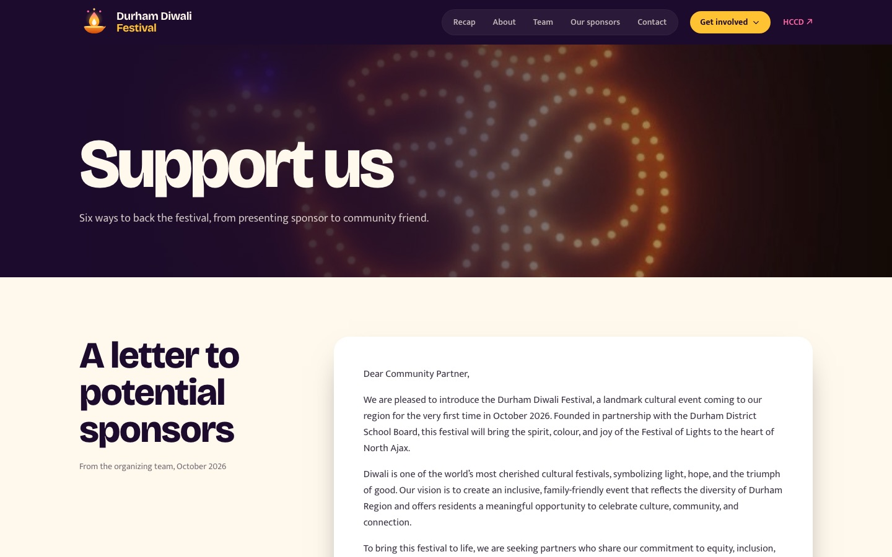
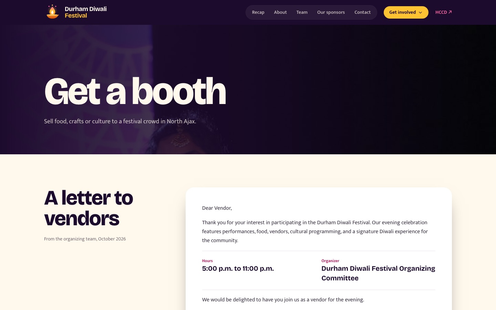
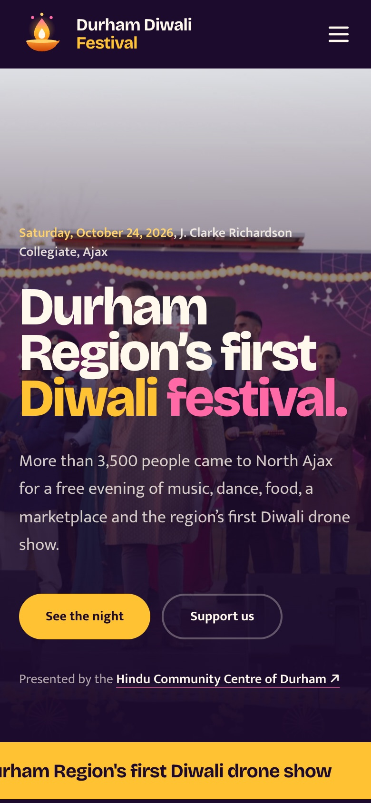
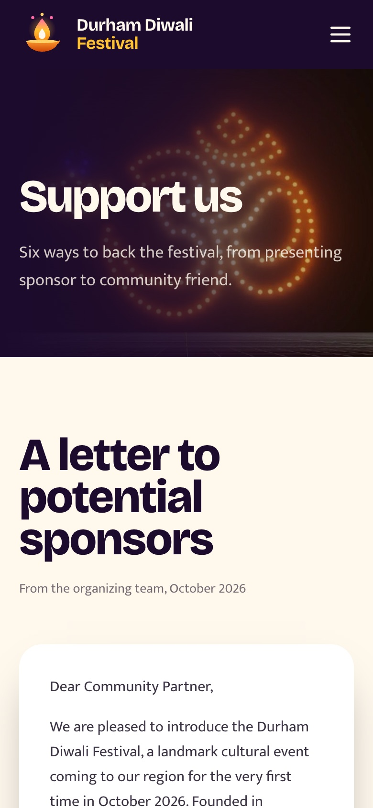

# Durham Diwali Festival 2026

Website for the **Durham Diwali Festival**, the first Diwali (Festival of Lights) celebration in Ajax, Ontario. It's presented by the Durham Diwali Festival Organizing Committee in partnership with the Durham District School Board. The site promotes the event, recruits sponsors and vendors, and collects sign-ups for event updates.

**Live site:** https://diwalifestdurham.netlify.app



<table>
  <tr>
    <td width="50%"></td>
    <td width="50%"></td>
  </tr>
  <tr>
    <td align="center">Sponsors</td>
    <td align="center">Vendors</td>
  </tr>
</table>

<table>
  <tr>
    <td align="center"><br>Home on a phone</td>
    <td align="center"><br>Sponsors on a phone</td>
  </tr>
</table>

## Who it's for

- **Residents of Durham Region** finding out what, when and where the festival is
- **Sponsors** comparing sponsorship tiers ($500–$20,000)
- **Vendors** applying for food and marketplace booth packages
- **Volunteers and community partners** getting in touch

## My role

I designed and built the website for the organizing committee: visual design built around the committee's existing logo, the React front end, sponsorship and vendor package pages, Netlify Forms lead capture, and deployment.

## Features

- Single-page home with anchored sections: welcome, 2026 in pictures, mission, vision, team, sponsors and contact
- Dedicated **Sponsorship Packages** and **Vendor Packages** pages, generated from typed data files
- **Contact** form submitted to Netlify Forms, with honeypot spam protection
- Downloadable event flyer (PDF)
- Accessible markup (Lighthouse accessibility score 100) and reduced-motion support

## Tech stack

| Layer      | Choice                                   |
| ---------- | ---------------------------------------- |
| Framework  | React 18 + TypeScript                    |
| Build tool | Vite 5                                   |
| Routing    | React Router 6                           |
| Styling    | Tailwind CSS 3, custom design tokens     |
| Icons      | lucide-react                             |
| Forms      | Netlify Forms                            |
| Hosting    | Netlify (auto-deploys from `main`)       |

## Architecture

The site is a static single-page app with no backend of its own.

```
Browser ──► Netlify CDN ──► index.html + hashed JS/CSS (cached for a year)
   │
   └── form POSTs ──► Netlify Forms
                      (index.html contains hidden copies of each form so
                       Netlify's build bot can register them; React submits
                       to the same form names via fetch)
```

```
index.html               Meta tags, fonts, hidden Netlify form definitions
netlify.toml             Build, SPA redirect, asset cache headers
public/                  logo.jpg, flyer (JPG + PDF), team photos, robots.txt
src/
  App.tsx                Routes: /, /sponsorship-packages, /vendor-packages, 404
  pages/                 One component per route
  components/home/       Home page sections (Hero, Recap, Mission, Vision, Team, Sponsors, CallToAction, Contact)
  components/            Navbar, Footer, Logo, PageHero, decorative motifs
  data/                  Team roster, sponsorship tiers, vendor packages
  lib/netlifyForms.ts    Form submission helper
```

## Local setup

Requires Node.js 20 (see `.nvmrc`) and npm.

```bash
git clone https://github.com/anujmish1229/diwalifestdurham.git
cd diwalifestdurham
npm install
npm run dev        # http://localhost:5173
```

| Script            | What it does                                  |
| ----------------- | --------------------------------------------- |
| `npm run dev`     | Vite dev server                               |
| `npm run build`   | Type-check (`tsc -b`) and build into `dist/`  |
| `npm run preview` | Serve the production build                    |
| `npm run lint`    | ESLint                                        |

Form submissions only work on the deployed Netlify site.

## Environment variables

None.
